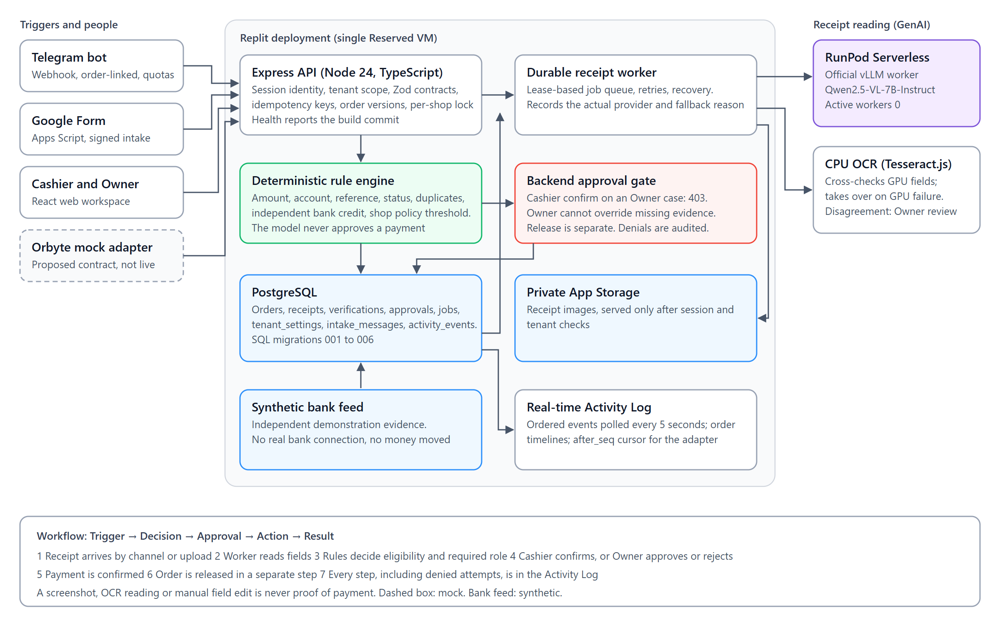

# PaySah architecture

PaySah is a modular monolith on one Replit deployment. It reads customer payment receipts, compares them with independent bank evidence and leaves payment and release decisions with authorised people.

The source diagram is [architecture.svg](architecture.svg). The bank feed is synthetic and the Orbyte adapter is a mock; PaySah connects to no real bank or Orbyte service and moves no money.

## Components

| Component | Technology | Responsibility | Source |
| --- | --- | --- | --- |
| Web workspace | React 19, Vite 7 | Orders, receipts, approvals, activity for Cashier and Owner | `src/apps/web` |
| API | Node 24, Express 5, TypeScript, Zod | Sessions, tenant scope, permissions, idempotency, order versions | `src/apps/api`, `src/packages/contracts` |
| Receipt worker | Node process, PostgreSQL job table | One extraction per process, lease recovery, provider and fallback recording | `src/apps/api/src/modules/receipts/worker.ts` |
| GenAI reader | RunPod Serverless, official vLLM worker, `Qwen/Qwen2.5-VL-7B-Instruct` | Reads structured fields from a receipt image | `src/apps/api/src/modules/receipts/runpod.ts`, [runpod/](../runpod/README.md) |
| CPU OCR | Tesseract.js | Cross-checks GPU fields and takes over when the GPU fails | `src/apps/api/src/modules/receipts` |
| Rule engine | TypeScript, `rules.v2-tenant-policy` | Decides eligibility and required role from evidence and shop policy | `src/apps/api/src/modules/verification/rules.ts` |
| Database | PostgreSQL, SQL migrations 001 to 006 | Orders, receipts, verifications, approvals, jobs, policies, audit events | `src/db/migrations` |
| Image storage | Replit App Storage, private bucket | Receipt images, returned only after session and tenant checks | `src/apps/api/src/modules/receipts` |
| Intake | Telegram webhook, Google Apps Script | Order-linked receipt submission; idempotent and quota-limited | `src/apps/api/src/modules/intake`, `src/integrations/google-form` |

## How GenAI, data and the interface connect

1. A receipt enters through Telegram, the Google Form or a staff upload. The API stores the image privately and writes a durable job.
2. The worker claims the job under a lease and sends the image to the RunPod endpoint through its OpenAI-compatible route. CPU OCR reads the same image. A disagreement raises `MODEL_UNCONFIRMED`. If the GPU fails, the worker falls back to CPU OCR and records the actual provider and reason.
3. Deterministic rules compare the fields with independent bank credits and the shop's policy, then store a verification result with its rule and policy versions.
4. The interface polls the API every five seconds and shows the next permitted action. Technical evidence stays in an expandable area.

## Trust boundaries

- **The model only reads.** It never decides eligibility or approves a payment.
- **A screenshot is not proof.** Eligibility needs exactly one unused matching bank credit and no blocking reason. Manual field edits raise a flag rather than establish payment.
- **The backend enforces roles.** The role comes from the database session, not from the browser. A Cashier calling the API directly on an Owner case gets 403 `OWNER_APPROVAL_REQUIRED`.
- **Owner approval cannot replace evidence.** Approval is a separate check from eligibility.
- **Payment and release are separate.** Owner `APPROVE` confirms payment in one transaction. Release is another request that uses the returned order version.
- **Tenants are isolated.** Another shop's object returns 404 and writes no denial event.
- **Old decisions go stale.** New evidence or a changed policy produces `STALE_APPROVAL`, so the case must be verified again.

## Multi-SME policy

`tenant_settings` holds each shop's business type, Owner review threshold, release threshold and policy version, all read-only through `GET /api/v1/tenant/settings`. Existing shops use RM500. The optional Demo Laundry C fixture uses RM200, so a RM300 payment can be confirmed by a bakery Cashier but needs the Owner at the laundry. Each shop has its own receipt and bank credit; a receipt is never reused across shops. There is no policy editing interface.

## Workflow events

| Step | Event in `activity_events` |
| --- | --- |
| Trigger | `intake.received`, `intake.rejected`, `receipt.image_saved` |
| Reading | `receipt.extracted`, with provider and fallback reason |
| Decision | `verification.completed` (this never means paid) |
| Approval | `approval.requested`, `approval.decided`, `access.denied` |
| Action and result | `payment.confirmed`, `fulfillment.released` |

The customer reply remains a draft (`sent:false`), which staff can copy. Automatic customer notification is not implemented.

## Failure behaviour

| Failure | Behaviour |
| --- | --- |
| GPU cold start, timeout or error | CPU OCR takes over; the provider and reason are recorded |
| Credit exhausted on RunPod | Same CPU route; this path should be rehearsed before any demo |
| OCR cannot read the image | Job ends in error; staff can correct fields manually and verify again, which still needs the Owner |
| Worker stops mid-job | Lease expires and another run recovers the job, up to its attempt limit |
| Audit write fails after a denial | The denied response is unchanged and the failure is logged |
| Policy missing | 503 `POLICY_UNAVAILABLE` |

## Related documents

[API additions](FINALIST_API.md), [Orbyte mock](ORBYTE_INTEGRATION.md), [exception demo](EXCEPTION_DEMO.md), [cost, privacy and scale](COST_PRIVACY_SCALE.md), [measurement protocol](FINALIST_MEASUREMENT.md), [release runbook](FINALIST_RUNBOOK.md), [local evidence](evidence/README.md).
